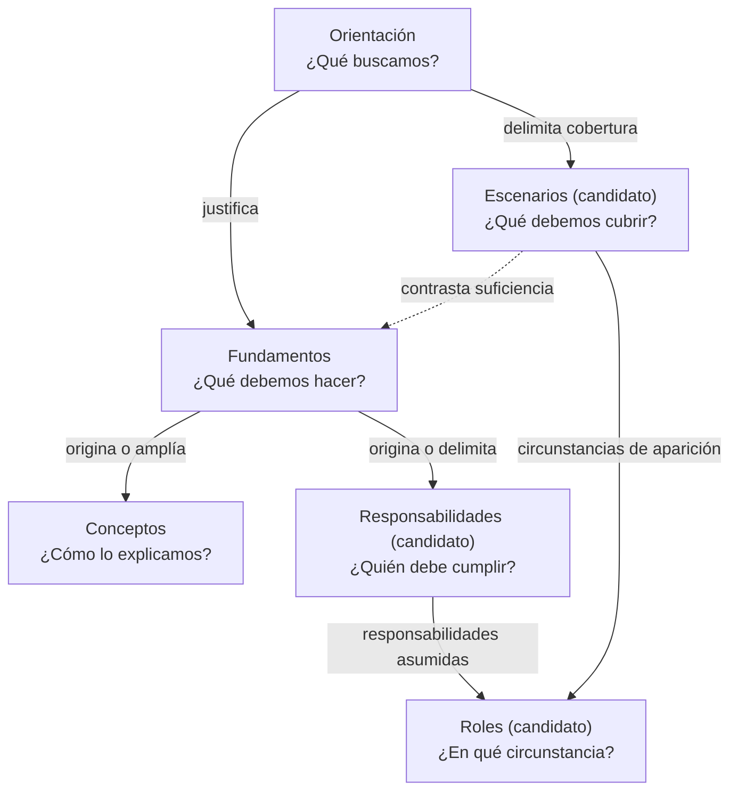

# TDidacta

**TDidacta es un sistema de enseñanza y aprendizaje** que busca facilitar experiencias para explorar, experimentar y desarrollar comprensión. Reconoce a quienes enseñan y aprenden como participantes activos, sin imponer una única trayectoria educativa.

Este repositorio conserva las **definiciones canónicas de TDidacta**. Las propuestas, la evidencia y las realizaciones se distinguen de las definiciones vigentes; no adquieren autoridad automáticamente.

## Ramificación conceptual de TDidacta

La siguiente es la **estructura de derivación propuesta** para organizar las definiciones sin duplicarlas. **Orientation, Foundations y Concepts** ya tienen documentos propios; **Responsibilities, Scenarios y Roles** son superficies candidatas todavía por delimitar. El esquema no adopta nuevas carpetas ni modifica los fundamentos F01–F10 reconciliados.

| Superficie | Pregunta que responde | Límite de su definición |
| --- | --- | --- |
| **[Orientación](orientation/README.md)** | ¿Qué buscamos? | Expresa los objetivos y remite a fundamentos y escenarios; no los redefine. |
| **Escenarios** *(superficie candidata)* | ¿Qué situaciones debemos cubrir para cumplir lo que buscamos? | Describe condiciones y casos de cobertura; no repite roles ni responsabilidades. |
| **[Fundamentos](foundations/README.md)** | ¿Qué debemos hacer para cumplir lo que buscamos? | Expresa respuestas constitutivas de TDidacta a la orientación, sin definir exhaustivamente conceptos ni asignar obligaciones a roles. |
| **[Conceptos](concepts/README.md)** | ¿Cómo explicamos lo que hacemos? | Conserva los significados y distinciones semánticas a los que remiten los fundamentos. |
| **Responsabilidades** *(superficie candidata)* | ¿Quién debe cumplir lo que hacemos? | Delimita compromisos y condiciones de cumplimiento, sin asignarlos por defecto a un rol concreto. |
| **Roles** *(superficie candidata)* | ¿Qué función aparece en qué circunstancia y qué responsabilidad tiene? | Vincula responsabilidades con escenarios particulares; una persona puede ejercer más de un rol. |

### Derivaciones y contraste de cobertura

**Regla principal: definir una vez y referenciar después.** Orientación no reproduce el detalle de Fundamentos o Escenarios; Fundamentos remite a Conceptos y Responsabilidades sin copiar sus definiciones; Escenarios remite a Roles sin volver a definirlos. Las conexiones son trazabilidad conceptual, no un proceso obligatorio ni una estructura de directorios adoptada.

**Los escenarios también contrastan los fundamentos.** Si una situación que debemos cubrir revela una omisión, tensión o insuficiencia de algún fundamento, se documenta el hallazgo y se propone una revisión explícita: **no se crea ni modifica automáticamente un fundamento**. De esta forma, los escenarios comprueban cobertura además de contextualizar roles.

**Dos sentidos distintos de «escenario»:** la superficie candidata *Escenarios* describe casos de cobertura de TDidacta; el concepto vigente [Escenario pedagógico](concepts/application-circumstances.md) describe circunstancias para aplicar una intención pedagógica (tipos base y especializado, reconciliados en F10). Pueden vincularse, pero no son sinónimos.

**Governance no es Responsibilities:** [Gobernanza documental](governance/README.md) trata autoridad, procedencia y evolución de las **definiciones del proyecto**, no asigna por sí misma compromisos pedagógicos a participantes.

Esta propuesta se revisará antes de retomar los [28 tópicos V6](notes/tdidacta-v6-coverage-bootstrap.md). La auditoría Foundations → Mechanisms queda pospuesta y la condición investigativa O3/F10 sigue pendiente. [Antecedentes y decisiones de cobertura](notes/2026-10-18-foundations-candidate-coverage-audit.md).

## Navegación

| Superficie | Qué encontrarás |
| --- | --- |
| [Orientación para agentes](AGENTS.md) | Cómo colaborar sin confundir fuentes, estados ni autoridad documental |
| [Índice para LLM](llms.txt) | Descubrimiento rápido de las fuentes canónicas y especializadas |
| [Orientación](orientation/README.md) | Propósito, problema abordado, alcance e idioma |
| [Foundations](foundations/README.md) | Conceptos reconocidos y definiciones candidatas |
| [Mechanisms](mechanisms/README.md) | Espacios delimitados y operaciones candidatas de exploración/realización |
| [Relationships](relationships/README.md) | Relaciones candidatas entre necesidades, intenciones, espacios y operaciones |
| [Lifecycle](lifecycle/README.md) | Coordinación recursiva candidata para abordar necesidades pedagógicas |
| [Productos](products/README.md) | Familia propuesta y responsabilidades todavía abiertas |
| [Transparencia](transparency/README.md) | Clasificación y atribución de recursos, anonimato y consentimiento; propuesta candidata |
| [Gobernanza documental](governance/README.md) | Autoridad, procedencia, evolución y diferencias entre canon, evidencia y propuestas |
| [Postulaciones y financiamiento](governance/funding-and-applications.md) | Cómo derivar abstracts y solicitudes fieles al canon |
| [Bootstrap](bootstrap/README.md) | Origen histórico en Teaching y evolución inicial |
| [Bootstrap operativo V6](notes/tdidacta-v6-coverage-bootstrap.md) | Seguimiento reutilizable de 28 tópicos, correspondencias y decisiones pendientes |
| [Notas externas](notes/external/2026-10-16-vslices-conceptual-correspondences.md) | Hipótesis de correspondencias con VSlices; no validadas |
| [Reglas de generación de proyectos](https://github.com/the-alive-lab/project-generation-rules) | Referencia transversal para estructura, descubrimiento humano y orientación de agentes; incluye [guía de creación](https://github.com/the-alive-lab/project-generation-rules/blob/main/guides/bootstrap.md) y [reglas de descubrimiento](https://github.com/the-alive-lab/project-generation-rules/blob/main/rules/human-and-agent-discovery.md) |
| [Reglas de visualización compartidas](https://github.com/the-alive-lab/visualization-rules) | Referencia editorial transversal de The Alive Lab; incluye [guía práctica](https://github.com/the-alive-lab/visualization-rules/blob/main/guides/application.md) y [entrada para agentes](https://github.com/the-alive-lab/visualization-rules/blob/main/AGENTS.md) |

## Estado

La estructura conceptual sigue **en elaboración**. Las definiciones candidatas de Foundations y Relationships, la familia de productos propuesta y posibles representaciones como TDIR no constituyen una arquitectura ni una metodología universal adoptadas.

Las revisiones deben respetar las fuentes, sus estados y las decisiones de promoción. Para detalles, consultar [gobernanza documental](governance/README.md).

## Visualización documental

Las [Visualization Rules de The Alive Lab](https://github.com/the-alive-lab/visualization-rules) sirven como **referencia compartida** para representar conceptos, relaciones, mecanismos y ciclos con claridad y fidelidad semántica. Incluyen [reglas editoriales](https://github.com/the-alive-lab/visualization-rules/blob/main/rules/document-visualizations.md), una [guía de aplicación](https://github.com/the-alive-lab/visualization-rules/blob/main/guides/application.md) y superficies para agentes ([AGENTS.md](https://github.com/the-alive-lab/visualization-rules/blob/main/AGENTS.md) y [llms.txt](https://github.com/the-alive-lab/visualization-rules/blob/main/llms.txt)).

Este enlace **no constituye una adopción normativa automática** ni cambia las definiciones canónicas de TDidacta. Cualquier aplicación concreta debe respetar la autoridad y el estado de los documentos de este repositorio, así como sus decisiones de promoción.

## Generación y evolución documental del proyecto

**Para extender o reorganizar este repositorio:** comenzar por [AGENTS.md](AGENTS.md), revisar las responsabilidades existentes y consultar las [Project Generation Rules](https://github.com/the-alive-lab/project-generation-rules) antes de proponer nuevas estructuras. Son referencias compartidas y no se adoptan automáticamente como normas de TDidacta.

Las [Project Generation Rules de The Alive Lab](https://github.com/the-alive-lab/project-generation-rules) son una **referencia transversal** para organizar proyectos, facilitar su reconocimiento por personas y agentes y conservar continuidad cuando evolucionan. Incluyen [reglas de fundamentación](https://github.com/the-alive-lab/project-generation-rules/blob/main/rules/project-foundation.md), [criterios de descubrimiento](https://github.com/the-alive-lab/project-generation-rules/blob/main/rules/human-and-agent-discovery.md), [guía de evolución](https://github.com/the-alive-lab/project-generation-rules/blob/main/guides/evolution.md) y entradas para agentes ([AGENTS.md](https://github.com/the-alive-lab/project-generation-rules/blob/main/AGENTS.md) y [llms.txt](https://github.com/the-alive-lab/project-generation-rules/blob/main/llms.txt)).

El vínculo constituye una **referencia, no una adopción normativa automática** ni una reestructuración de TDidacta. Las definiciones canónicas, la gobernanza y las decisiones específicas de este proyecto conservan su autoridad. TDidacta dispone de entradas propias para agentes ([AGENTS.md](AGENTS.md)) y descubrimiento por LLM ([llms.txt](llms.txt)); ambas enlazan las fuentes existentes sin duplicar ni redefinir el canon.
