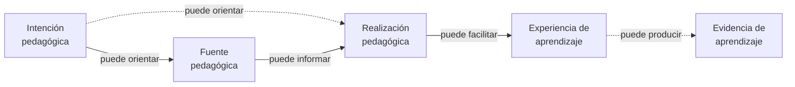

# Inventario de conceptos candidatos

**Estado:** candidate. Significados de trabajo derivados de la [V6 aprobada](https://github.com/vslices/research-space/blob/main/lines/educational-capacity-under-institutional-constraints/notes/learning-tools-competition-2027/notes/2026-10-15-tdidacta-master-v6-preservation.md), sin promoción automática.

| Concepto | Significado de trabajo | Frontera pendiente |
| --- | --- | --- |
| **Responsabilidad pedagógica** | Compromisos y razones para orientar o sostener la enseñanza y el aprendizaje; Hernán ha precisado que es **compartida** por quienes enseñan y aprenden, sin imponer obligaciones idénticas | Determinar condiciones, distribución de autoridad y relación con aprendizaje autodidacta |
| **Intención pedagógica** | Comprensión, práctica o experiencia que un actor espera favorecer, con razones y límites pertinentes | ¿Quién puede formularla, revisarla o desafiarla? ¿Puede emerger durante la experiencia? |
| **Fuente pedagógica** | Representación consultable de conocimiento, orientación o decisiones pertinentes | No confundir fuente, documento, autoría y autoridad |
| **Realización pedagógica** | Material o experiencia concreta que expresa o pone a prueba una responsabilidad en un contexto | ¿Qué se preserva entre realizaciones y cómo se verifica? |
| **Exploración y autonomía** | Candidatura abordada mediante [F09 — Autonomía del aprendiz](learner-autonomy.md): exploración es capacidad general; autonomía y diseño son usos distintos | Fundamento y capas conceptuales reconciliados (2026-10-18) |
| **Continuidad pedagógica** | Posibilidad de reconstruir y revisar conexiones entre necesidades, razones, experiencias y evidencia a través del tiempo | No presuponer cadena lineal ni registro exhaustivo |
| **Adaptación** | Modificación situada de medios, ejemplos, profundidad o apoyos | Personalización o conformidad no demuestran aprendizaje |

Se documentan aparte [necesidades e intenciones pedagógicas](pedagogical-needs-and-intentions.md), [espacios de posibilidades](../mechanisms/possibility-spaces.md), [exploración y realización](../mechanisms/exploration-and-realization.md), y [resolución recursiva](../lifecycle/recursive-pedagogical-resolution.md) porque poseen distinciones y preguntas propias. Esas definiciones afinan este inventario sin promocionarlo a canon.

## Distinciones a conservar

- **Enseñar ≠ garantizar aprendizaje.**
- **Intención ≠ trayectoria obligatoria.**
- **Fuente ≠ realización.**
- **Autoría ≠ autoridad.**
- **Conformidad ≠ calidad pedagógica ≠ resultados de aprendizaje.**
- **Canon ≠ evidencia ≠ hipótesis.**

## Visualización de fuente, realización y aprendizaje

**Pregunta de lectura:** ¿cómo distinguir una fuente pedagógica, una realización pedagógica y los posibles resultados de aprendizaje, sin convertirlos en una cadena obligatoria?

**Cómo leerlo:** la visualización distingue conceptos que a menudo se confunden. Una intención pedagógica puede orientar una fuente o una realización. Una fuente puede informar una realización, pero no se identifica con ella. Una realización puede facilitar experiencias de aprendizaje, y estas pueden producir alguna forma de evidencia, sin que ello ocurra siempre ni de una sola manera.

**Lectura textual equivalente:** una fuente pedagógica puede servir de apoyo, referencia o representación consultable para una realización. Una realización pedagógica es una experiencia o material concreto que expresa o pone a prueba una responsabilidad en un contexto. Esa realización puede facilitar experiencias de aprendizaje, y dichas experiencias pueden producir alguna evidencia, aunque ni la conformidad de la realización ni la existencia de una fuente demuestren por sí mismas aprendizaje.

**Límites:** el diagrama no representa una secuencia obligatoria ni una dependencia universal. Una realización puede existir sin una fuente documental explícita. La evidencia de aprendizaje puede ser parcial, situada o difícil de observar. El diagrama tampoco resuelve por sí mismo las fronteras entre autoría, autoridad, calidad pedagógica y resultados. Comparte el **estado candidato** de este inventario conceptual.

## Límite

Los conceptos son candidatos y no definen automáticamente Method, Design, Docs Standard, Framework o Platform. Una propuesta o testimonio explícito puede orientar su elaboración sin equivaler a validación empírica.

**Relacionados:** [Enseñanza y aprendizaje](teaching-and-learning.md) · [Espacio de posibilidades](../mechanisms/possibility-spaces.md) · [Criterios de madurez](scope-and-promotion.md).

## Trazabilidad a orientaciones

Este archivo es un **inventario de candidatos**, no un fundamento indivisible. Su justificación transversal es la [orientación principal](../orientation/README.md); las relaciones de cada concepto con [continuidad](../orientation/semantic-continuity.md), [tecnologías](../orientation/technology-enabled-semantic-continuity.md) y [carga/capacidad](../orientation/human-effort-and-agency.md) deben comprobarse individualmente antes de promoción. Incorporar o modificar una orientación obliga revisar cada entrada del inventario, además de las tablas de fundamentos individuales.

## Hipótesis de clasificación pendiente (2026-10-16)

El fundador plantea que este inventario podría corresponder a un **mecanismo para formalizar fundamentos de modo utilizable**, en vez de constituir un fundamento. **No se reclasifica ni mueve por ahora**: antes debe distinguirse si el documento solamente enumera conceptos (función editorial), si los formaliza con reglas de uso (posible mecanismo) o si contiene fundamentos aún no separados. Esta pregunta requiere contraste en la próxima auditoría Foundations→Mechanisms. La revisión transversal de orientaciones incluye los conceptos aquí contenidos, especialmente [autorización humana](../orientation/human-pedagogical-authorization.md) y [reconocimiento de aportes](../orientation/transparent-contribution-recognition.md).
