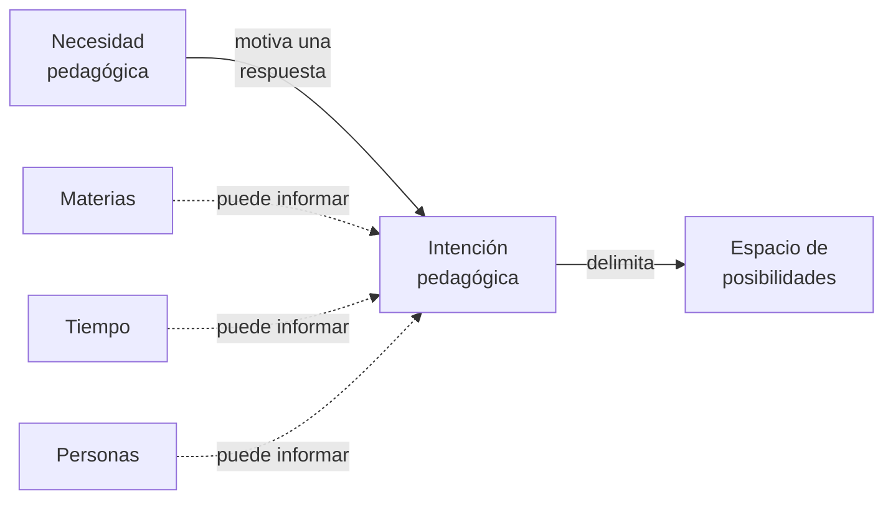

# F02 — Necesidades e intenciones pedagógicas

**Estado:** fundamento conceptual reconciliado con las orientaciones por decisión del fundador (2026-10-16). La reconciliación no constituye validación empírica de eficacia.

## 1. Origen y propósito

Este fundamento nace conjuntamente de **O0 — Orientación principal**, que determina la problemática pedagógica a atender, y **O1 — Continuidad semántica**, que fundamenta formular una respuesta cuyo significado, razones y restricciones puedan reconocerse y reconstruirse.

TDidacta aborda necesidades de enseñanza, aprendizaje o apoyo educativo mediante la formulación de **intenciones pedagógicas**. La necesidad expresa el problema; la intención es una respuesta deliberada y semánticamente identificable. Formular una intención no demuestra por sí solo que la respuesta sea eficaz ni exige una realización tecnológica.

## 2. Necesidad pedagógica

Una **necesidad pedagógica** expresa algo que requiere ser abordado mediante enseñanza, aprendizaje o apoyo educativo. Puede proceder de una institución, del contexto, de quien aprende o de otros participantes.

No tiene escala fija: una necesidad puede atenderse con una actividad, clase, unidad, planificación amplia u otra respuesta. Su tamaño no determina una jerarquía obligatoria.

## 3. Intención pedagógica

Una **intención pedagógica** es la respuesta deliberada que formula quien asume la responsabilidad de enseñar al interpretar, organizar y delimitar una necesidad. Puede expresar propósitos, condiciones, restricciones, conexiones y alternativas.

Una planificación anual, semestral, unidad, clase o actividad puede expresar una intención pedagógica: son **escalas y funciones posibles del mismo concepto**, no tipos fundamentales distintos.

Una intención puede originar intenciones más específicas sin que toda necesidad requiera esa subdivisión. La continuidad semántica requiere que sus motivos, significados y restricciones relevantes puedan interpretarse y reconstruirse al cambiar escalas, versiones o realizaciones, sin imponer documentación exhaustiva.

## 4. Relación con el espacio de posibilidades

La **intención** corresponde a la perspectiva de quien formula la respuesta pedagógica. Como consecuencia de sus decisiones y restricciones, **delimita un espacio de posibilidades** sobre el que personas o realizadores —incluidos LLM— pueden explorar o realizar.

No se afirma identidad semántica entre intención y espacio: se propone una **relación de delimitación**. Los humanos ya consideran y recorren posibilidades sin requerir formalizar esta abstracción.

**Complemento O2 — Aprovechamiento tecnológico:** describir posibilidades mediante intenciones y restricciones ofrece una perspectiva útil para emplear herramientas generativas que exploren o produzcan alternativas. La tecnología puede hacer esta perspectiva más practicable, pero **no crea el espacio de posibilidades** ni es requisito para que exista una intención.

**Condición O3 — Carga y capacidad humana:** esta distribución puede permitir que las personas se concentren en delimitar, restringir, orientar y revisar, mientras las herramientas apoyan la exploración y producción. No se presupone que reduzca efectivamente el esfuerzo: revisar demasiadas alternativas también puede aumentar la carga.

## 5. Mapa conceptual de necesidad, intención y espacio

**Pregunta de lectura:** ¿cómo una necesidad da lugar a una respuesta pedagógica deliberada y cómo esa respuesta delimita posibilidades, sin convertir las dimensiones del problema en requisitos fijos?

**Cómo leerlo:** una necesidad pedagógica puede motivar la formulación de una intención por quien asume la responsabilidad de enseñar. La intención **delimita**, pero no es idéntica al espacio de posibilidades resultante. Materias, tiempo y personas aparecen como **consideraciones candidatas** que pueden informar la formulación o revisión de esa intención; las conexiones discontinuas no las convierten en entradas obligatorias.

**Lectura textual equivalente:** ante una necesidad de enseñanza o aprendizaje, una persona responsable puede formular una intención con propósitos, condiciones y restricciones. Las decisiones de esa intención delimitan posibilidades para explorar o realizar. Según el contexto, pueden considerarse conocimientos y relaciones entre materias, trayectorias temporales y condiciones de quienes aprenden.

**Límites:** este mapa no representa una secuencia operativa obligatoria, una jerarquía de escalas, tres ejes métricos ni un inventario exhaustivo. Tampoco afirma que formular una intención asegure el aprendizaje. Es una representación conceptual, no una realización operativa ni garantía de eficacia.

## 6. Dimensiones del problema

- **Materias:** conceptos, disciplinas, prerrequisitos y relaciones transversales.
- **Tiempo:** orden, distribución, oportunidad y trayectorias plausibles.
- **Personas:** conocimientos previos, necesidades y condiciones de individuos o grupos.

Son dimensiones candidatas, no ejes métricos obligatorios ni un inventario exhaustivo. La coherencia temporal entre materias necesita contrastarse con las necesidades de personas reales.

**Caso ilustrativo aportado por el fundador:** comprender el valor de MVVM para testing puede requerir conectar lo enseñado sobre separación de responsabilidades en Arquitectura de Software con otra materia, en una secuencia comprensible para el grupo.

## 7. Complementos a la formulación

**O4 — Autorización humana:** una intención formulada no queda automáticamente autorizada. La aprobación pedagógica es una decisión humana distinguible de la formulación, con reglas propias.

**O5 — Reconocimiento de aportes:** la formulación o revisión de una intención puede incorporar contribuciones humanas e inferenciales relevantes. Reconocer su procedencia y participación no equivale a autorizar la intención ni a asignar automáticamente responsabilidad por ella.

Ninguno de estos complementos sustituye la identidad conceptual de necesidad e intención.

## 8. Tensión aplicable: O1 ↔ O3, atenuable mediante O2

Este fundamento está afectado por la [tensión entre continuidad semántica y esfuerzo humano](../tensions/semantic-continuity-human-effort.md):

- **O1** exige conservar y poder reconstruir significados, razones, conexiones y restricciones relevantes.
- **O3** exige evitar que esa continuidad imponga cargas humanas desproporcionadas o reduzca la capacidad de acción.
- **O2** puede **atenuar** la tensión mediante asistencia tecnológica a la formulación, reconstrucción, exploración y revisión; **no es uno de los polos** de la tensión.

Los mecanismos que realicen este fundamento deberán explicar cómo responden a la tensión y cuáles son sus límites. La asistencia tecnológica es una **vía propuesta de atenuación**, no una demostración de que se haya reducido el esfuerzo o resuelto la tensión.

## 9. Fronteras

- La coherencia de una planificación no demuestra aprendizaje efectivo.
- Una intención amplia puede relacionarse con otras por dependencias y conexiones, no solo por contención.
- La organización no exige árbol único ni secuencia universal.
- La responsabilidad de aprender no queda absorbida por quien formula la intención.
- La intención delimita posibilidades, pero no requiere obligatoriamente tecnología ni un espacio formalmente implementado.
- Una intención puede existir antes de ser autorizada y sin que cada contribución esté registrada exhaustivamente.
- Ninguna realización generada queda validada por el solo hecho de respetar una formulación aparente de la intención.

**Relacionados:** [Espacios de posibilidades](../mechanisms/possibility-spaces.md) · [Explorar y realizar](../mechanisms/exploration-and-realization.md) · [Resolución recursiva](../lifecycle/recursive-pedagogical-resolution.md).

## 10. Trazabilidad con las orientaciones

| Orientación | Clasificación | Justificación |
| --- | --- | --- |
| [O0 — Principal](../orientation/README.md) | **Origen** | Define la problemática educativa que debe abordarse mediante necesidades e intenciones pedagógicas. |
| [O1 — Continuidad semántica](../orientation/semantic-continuity.md) | **Origen** | Fundamenta expresar respuestas como intenciones con significado, motivos y restricciones reconstruibles. |
| [O2 — Aprovechamiento tecnológico](../orientation/technology-enabled-semantic-continuity.md) | **Complemento** | Permite aprovechar tecnológicamente la perspectiva de espacios de posibilidades y atenuar la carga de continuidad semántica. |
| [O3 — Carga y capacidad humana](../orientation/human-effort-and-agency.md) | **Condición** | Exige procurar una distribución del esfuerzo que no vuelva impracticable la formulación, seguimiento y revisión de intenciones. |
| [O4 — Autorización humana](../orientation/human-pedagogical-authorization.md) | **Complemento** | Exige distinguir la intención formulada de su eventual aprobación humana. |
| [O5 — Reconocimiento de aportes](../orientation/transparent-contribution-recognition.md) | **Complemento** | Permite reconocer contribuciones relevantes a la construcción y revisión de intenciones sin equipararlas a aprobación. |
| [O6 — Inversión del esfuerzo](../orientation/effort-inversion.md) | **Incidencia marginal** | Priorizar comprender necesidades y formular intenciones antes de producir realizaciones puede favorecer el uso de estos conceptos, pero no determina su definición ni el espacio de posibilidades. |

### Revisión de O6

La incidencia de O6 es **marginal**: favorece concentrar atención en interpretar necesidades y formular intenciones, pero la inversión del esfuerzo se vuelve **condición material en F03**, donde se exige documentar suficientemente. La tensión O3/O6 no se activa automáticamente en F02 por esta relación marginal.

## 11. Criterio de mantenimiento

Cuando cambien las orientaciones, revisar si cambian la justificación, condiciones, complementos o tensiones aplicables. Las tensiones pueden descubrirse progresivamente; su presencia no equivale a una solución implementada ni bloquea por sí sola la definición conceptual del fundamento.

**Fuentes de origen:** [O0 — Orientación principal](../orientation/README.md) y [O1 — Continuidad semántica](../orientation/semantic-continuity.md).
