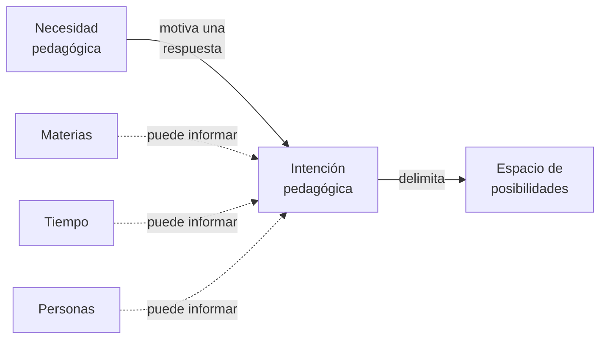

# Necesidades e intenciones pedagógicas

**Estado:** modelo conceptual candidato de TDidacta; reconstrucción de las precisiones del fundador, no validación general.

## Necesidad pedagógica

Una **necesidad pedagógica** expresa algo que requiere ser abordado mediante enseñanza, aprendizaje o apoyo educativo. Puede proceder de una institución, del contexto, de quien aprende o de otros participantes.

No tiene escala fija: una necesidad puede atenderse con una actividad, clase, unidad, planificación amplia u otra respuesta. Su tamaño no determina una jerarquía obligatoria.

## Intención pedagógica

Una **intención pedagógica** es la respuesta deliberada que formula quien asume la responsabilidad de enseñar al interpretar, organizar y delimitar una necesidad. Puede expresar propósitos, condiciones, restricciones, conexiones y alternativas.

Una planificación anual, semestral, unidad, clase o actividad puede expresar una intención pedagógica: son **escalas y funciones posibles del mismo concepto candidato**, no tipos fundamentales distintos.

Una intención puede originar intenciones más específicas sin que toda necesidad requiera esa subdivisión.

## Relación con el espacio de posibilidades

La **intención** corresponde a la perspectiva de quien formula la respuesta pedagógica. Como consecuencia de sus decisiones y restricciones, **delimita un espacio de posibilidades** sobre el que personas o realizadores —incluidos LLM— pueden explorar o realizar.

No se afirma identidad semántica entre intención y espacio: se propone una **relación de delimitación**.

## Mapa conceptual de necesidad, intención y espacio

**Pregunta de lectura:** ¿cómo una necesidad da lugar a una respuesta pedagógica deliberada y cómo esa respuesta delimita posibilidades, sin convertir las dimensiones del problema en requisitos fijos?

**Cómo leerlo:** una necesidad pedagógica puede motivar la formulación de una intención por quien asume la responsabilidad de enseñar. La intención **delimita**, pero no es idéntica al espacio de posibilidades resultante. Materias, tiempo y personas aparecen como **consideraciones candidatas** que pueden informar la formulación o revisión de esa intención; las conexiones discontinuas no las convierten en entradas obligatorias.

**Lectura textual equivalente:** ante una necesidad de enseñanza o aprendizaje, una persona responsable puede formular una intención con propósitos, condiciones y restricciones. Las decisiones de esa intención delimitan posibilidades para explorar o realizar. Según el contexto, pueden considerarse conocimientos y relaciones entre materias, trayectorias temporales y condiciones de quienes aprenden.

**Límites:** este mapa no representa una secuencia operativa obligatoria, una jerarquía de escalas, tres ejes métricos ni un inventario exhaustivo. Tampoco afirma que formular una intención asegure el aprendizaje. Comparte el **estado candidato** de los conceptos descritos en esta página.

## Dimensiones del problema (candidatas)

- **Materias:** conceptos, disciplinas, prerrequisitos y relaciones transversales.
- **Tiempo:** orden, distribución, oportunidad y trayectorias plausibles.
- **Personas:** conocimientos previos, necesidades y condiciones de individuos o grupos.

No son ejes métricos obligatorios ni un inventario exhaustivo. La coherencia temporal entre materias necesita contrastarse con las necesidades de personas reales.

**Caso ilustrativo aportado por el fundador:** comprender el valor de MVVM para testing puede requerir conectar lo enseñado sobre separación de responsabilidades en Arquitectura de Software con otra materia, en una secuencia comprensible para el grupo.

## Fronteras

- La coherencia de una planificación no demuestra aprendizaje efectivo.
- Una intención amplia puede relacionarse con otras por dependencias y conexiones, no solo por contención.
- La organización no exige árbol único ni secuencia universal.
- La responsabilidad de aprender no queda absorbida por quien formula la intención.

**Relacionados:** [Espacios de posibilidades](../mechanisms/possibility-spaces.md) · [Explorar y realizar](../mechanisms/exploration-and-realization.md) · [Resolución recursiva](../lifecycle/recursive-pedagogical-resolution.md).

## Trazabilidad hacia las orientaciones vigentes

La orientación principal es **transversal** a este fundamento; las orientaciones complementarias se evalúan individualmente y no constituyen requisitos universales. Estas correspondencias son **explicaciones candidatas**, no pruebas de eficacia ni promoción conceptual.

| Orientación | Relación con este fundamento |
| --- | --- |
| [Orientación principal](../orientation/README.md) | Fundamento central de O0: interpretar problemas pedagógicos mediante necesidades e intenciones, como base de la respuesta educativa. |
| [Continuidad semántica](../orientation/semantic-continuity.md) | Facilitar reconstrucción del significado de necesidades e intenciones a través de escalas, cambios y realizaciones. |
| [Aprovechamiento tecnológico](../orientation/technology-enabled-semantic-continuity.md) | No es requisito constitutivo; pueden utilizarse herramientas de apoyo. |
| [Carga y capacidad](../orientation/human-effort-and-agency.md) | Explicitar intenciones puede ampliar agencia, pero su costo debe evaluarse. |

| [Autorización humana](../orientation/human-pedagogical-authorization.md) | Una intención formulada no queda autorizada por el mero hecho de existir. |
| [Reconocimiento de aportes](../orientation/transparent-contribution-recognition.md) | Reconocer contribuciones a su formulación sin equipararlas con aprobación. |

**Regla de mantenimiento:** agregar o modificar una orientación exige revisar esta tabla junto con las de **todos los fundamentos**; una fila de baja relevancia debe explicarlo, no inventar una dependencia.
