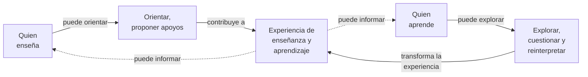

# Enseñanza y aprendizaje — orientaciones reconocidas

**Estado:** orientación ya presente en el [canon actual](../README.md). Este documento organiza sus implicaciones; no introduce por sí solo una promoción nueva.

## Enseñanza y aprendizaje

TDidacta es un sistema de **enseñanza y aprendizaje**. Facilita experiencias para explorar, experimentar y desarrollar comprensión. Enseñar no equivale solamente a publicar o transmitir contenidos; aprender no equivale a recibirlos.

Ambos fenómenos pueden darse fuera de instituciones, sin docente profesional presente y en medios diferentes de lo digital.

## Participación activa

Quienes enseñan y quienes aprenden son participantes activos, aunque sus responsabilidades concretas no sean idénticas.

Quien aprende puede explorar, cuestionar, cambiar de enfoque y producir interpretaciones no detalladas de antemano. Una intención previa no agota ni predetermina toda experiencia de aprendizaje.

## Visualización de la participación activa

**Pregunta de lectura:** ¿cómo participan activamente quien enseña y quien aprende en una experiencia, sin reducir enseñar a transmitir ni aprender a recibir?

**Cómo leerlo:** el grafo muestra dos perspectivas activas con contribuciones que no tienen por qué ser idénticas. Orientar y proponer apoyos no garantiza aprendizaje; explorar y reinterpretar no equivale a recibir pasivamente contenidos. Las conexiones de retorno muestran que la experiencia puede informar a ambos participantes.

**Lectura textual equivalente:** una experiencia puede construirse mediante propuestas de orientación y apoyo, junto con las exploraciones, preguntas e interpretaciones de quien aprende. Lo que ocurre en ella puede motivar revisiones tanto de la enseñanza como del propio aprendizaje.

**Límites:** los nodos representan **roles o perspectivas, no necesariamente personas diferentes**: en el aprendizaje autodidacta pueden coincidir. El diagrama no exige un docente profesional, un entorno institucional, un medio digital ni una secuencia fija. Tampoco implica que la presencia de estas operaciones garantice aprendizaje efectivo. Esta visualización ilustra las orientaciones reconocidas, sin añadir un modelo formal nuevo.

## Contexto y multiplicidad

Las experiencias pueden ocurrir en diferentes entornos, medios y condiciones. Una necesidad no exige una única realización; la adaptación contextual tampoco demuestra por sí misma eficacia pedagógica.

## Delimitación

Estas orientaciones no definen un lifecycle obligatorio, un modelo formal de aprendizaje, una jerarquía universal docente-estudiante ni una garantía de resultados.

**Fuente normativa de estas orientaciones:** [README principal](../README.md).

## Trazabilidad y naturaleza del documento

Este documento **se conserva como fundamento por decisión del fundador**: concreta la orientación principal en distinciones operables de enseñanza y aprendizaje sin confundir el propósito general con las capacidades fundacionales. [Orientación principal](../orientation/README.md) es su fuente directa; [continuidad](../orientation/semantic-continuity.md), [tecnologías](../orientation/technology-enabled-semantic-continuity.md) y [carga/capacidad](../orientation/human-effort-and-agency.md) pueden favorecerla, pero no definen su existencia. [Autorización humana](../orientation/human-pedagogical-authorization.md) delimita cuándo una propuesta educativa se aprueba humanamente, sin volver autorización toda experiencia; [reconocimiento de aportes](../orientation/transparent-contribution-recognition.md) distingue contribuciones de ambos participantes. Las revisiones de orientaciones deben verificar esta correspondencia.
