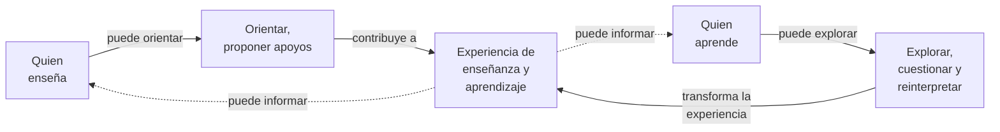

# F01 — Enseñanza y aprendizaje

**Estado:** fundamento conceptual reconciliado con orientaciones por aprobación del fundador (2026-10-16). No es una teoría universal ni una validación de eficacia.

## 1. Origen y propósito

TDidacta parte de comprender la enseñanza y el aprendizaje como experiencias que favorecen la exploración, la experimentación y el desarrollo de la comprensión.

Este fundamento nace de la **orientación principal de TDidacta (O0)** y establece cómo interpretamos la problemática pedagógica que pretendemos abordar.

Enseñar no equivale únicamente a transmitir o publicar contenidos; aprender no equivale únicamente a recibirlos.

Ambas actividades pueden ocurrir fuera de instituciones educativas, sin docentes profesionales presentes y mediante experiencias que no dependen necesariamente de medios digitales.

El fundamento no establece todavía cómo TDidacta resolverá esa problemática mediante tecnologías, mecanismos o procesos. Define la comprensión del problema sobre la que podrán desarrollarse otras capacidades.

## 2. Enseñanza y aprendizaje como experiencias participativas

Quienes enseñan y quienes aprenden son participantes activos de la experiencia educativa, aunque sus perspectivas y responsabilidades no sean idénticas.

**Desde la perspectiva de quien enseña**, una experiencia puede involucrar orientación, propuestas, apoyos y decisiones dirigidas a favorecer la comprensión.

**Desde la perspectiva de quien aprende**, puede involucrar exploración, cuestionamiento, reinterpretación, cambios de enfoque y construcción de comprensiones que no estaban completamente determinadas de antemano.

Estas perspectivas no necesariamente corresponden a personas distintas. En una experiencia autodidacta pueden coincidir.

Una intención pedagógica previa puede orientar una experiencia sin agotar ni predeterminar todo lo que ocurra durante ella.

### Visualización de la participación activa

**Pregunta de lectura:** ¿cómo participan activamente quien enseña y quien aprende en una experiencia, sin reducir enseñar a transmitir ni aprender a recibir?

**Cómo leerlo:** el grafo muestra dos perspectivas activas con contribuciones que no tienen por qué ser idénticas. Orientar y proponer apoyos no garantiza aprendizaje; explorar y reinterpretar no equivale a recibir pasivamente contenidos. Las conexiones de retorno muestran que la experiencia puede informar a ambos participantes.

**Lectura textual equivalente:** una experiencia puede construirse mediante propuestas de orientación y apoyo, junto con las exploraciones, preguntas e interpretaciones de quien aprende. Lo que ocurre en ella puede motivar revisiones tanto de la enseñanza como del propio aprendizaje.

**Límites del diagrama:** los nodos representan perspectivas, no necesariamente personas distintas; no impone docente profesional, institución, medios digitales ni secuencia fija. No garantiza aprendizaje ni introduce un modelo formal nuevo.

## 3. Significado de las experiencias

**Condición originada en O1 — Continuidad semántica.**

Una experiencia de enseñanza y aprendizaje no se comprende únicamente por las actividades realizadas o los materiales utilizados, sino también por los significados que sus participantes construyen, reinterpretan o cuestionan.

Las experiencias pueden transformar la comprensión de quienes participan y producir hallazgos que informen experiencias posteriores.

Por ello, al interpretar una experiencia educativa, deben considerarse sus significados, razones y cambios de comprensión relevantes, sin reducirla a una secuencia de actividades ni asumir que toda interpretación permanece inmutable.

La continuidad semántica condiciona así nuestra comprensión de la experiencia: su significado puede mantenerse, desarrollarse o reconstruirse a través del tiempo.

Esta condición no implica que toda experiencia deba documentarse exhaustivamente, ni que preservar su significado garantice aprendizaje.

## 4. Participación y reconocimiento de aportes

**Complemento originado en O5 — Reconocimiento transparente y trazable de aportes.**

La participación activa puede producir aportes significativos de quienes enseñan y de quienes aprenden.

Estos aportes pueden manifestarse mediante propuestas, interpretaciones, preguntas, modificaciones, observaciones o retroalimentación.

Una experiencia puede informar a cualquiera de sus participantes y motivar nuevas comprensiones o revisiones de lo que se enseña y aprende.

Cuando un aporte es relevante para comprender cómo se construyó o transformó una experiencia, su contribución y procedencia deberían poder reconocerse de manera transparente y trazable.

Reconocer un aporte no significa que todas las intervenciones tengan la misma responsabilidad, ni que participar convierta automáticamente a alguien en autor o responsable de la experiencia completa.

Este complemento tampoco exige registrar cada intervención mínima o transformar toda experiencia en un procedimiento documental.

## 5. Contexto y multiplicidad de experiencias

Las experiencias de enseñanza y aprendizaje pueden ocurrir en diferentes entornos, medios y condiciones.

Una misma necesidad pedagógica no exige necesariamente una única respuesta o realización.

Las experiencias pueden diferir según las personas involucradas, sus circunstancias, los medios disponibles y las comprensiones que se desarrollen durante su transcurso.

La adaptación contextual puede resultar pertinente sin que ello demuestre automáticamente eficacia pedagógica.

## 6. Límites del fundamento

Este fundamento no establece:

- Un modelo formal universal del aprendizaje.
- Una jerarquía obligatoria entre docentes y estudiantes.
- La necesidad de que enseñar y aprender correspondan a personas distintas.
- Una trayectoria educativa única o una secuencia temporal obligatoria.
- La obligación de utilizar tecnologías digitales.
- Un proceso universal de documentación de experiencias.
- Que orientar una experiencia garantice aprendizaje.
- Que reconocer una contribución implique autoría, autoridad o aprobación pedagógica.

Tampoco define mecanismos de generación, autorización, publicación o evaluación de resultados. Estas responsabilidades deberán ser abordadas por los fundamentos y mecanismos correspondientes cuando estén justificadas por sus propias orientaciones.

## 7. Trazabilidad con las orientaciones

| Orientación | Clasificación | Justificación |
| --- | --- | --- |
| [O0 — Principal](../orientation/README.md) | **Origen** | F01 expresa cómo TDidacta comprende el problema de enseñanza y aprendizaje que su orientación principal pretende abordar. |
| [O1 — Continuidad semántica](../orientation/semantic-continuity.md) | **Condición** | Condiciona cómo comprendemos el significado de las experiencias, sus transformaciones y su continuidad temporal. |
| [O2 — Aprovechamiento tecnológico](../orientation/technology-enabled-semantic-continuity.md) | **Sin incidencia** | El fundamento interpreta la problemática pedagógica; no determina los medios tecnológicos para abordarla. |
| [O3 — Carga y capacidad](../orientation/human-effort-and-agency.md) | **Sin incidencia** | El fundamento no determina todavía cómo reducir esfuerzo o ampliar las capacidades operativas de los participantes. |
| [O4 — Autorización humana](../orientation/human-pedagogical-authorization.md) | **Sin incidencia** | Comprender la enseñanza y el aprendizaje no exige establecer quién puede autorizar elementos pedagógicos. |
| [O5 — Reconocimiento de aportes](../orientation/transparent-contribution-recognition.md) | **Complemento** | Complementa la participación activa al exigir que los aportes relevantes producidos durante las experiencias puedan reconocerse y reconstruirse. |
| [O6 — Inversión del esfuerzo](../orientation/effort-inversion.md) | **Sin incidencia** | F01 interpreta qué son las experiencias de enseñanza y aprendizaje, sin prescribir cómo distribuir esfuerzo entre comprender/documentar y producir realizaciones. |
| [O7 — Privacidad por diseño](../orientation/privacy-by-design-and-data-minimization.md) | **Sin incidencia** | La minimización de datos personales no determina cómo interpretamos la enseñanza y el aprendizaje. |
| [O8 — Reconocimiento externo de identidades](../orientation/external-personal-identity-recognition.md) | **Sin incidencia** | El reconocimiento de identidades personales, operativas y contextuales no constituye parte de esa interpretación pedagógica. |
| [O9 — Accesibilidad contextual](../orientation/contextual-access-and-educational-reach.md) | **Incidencia marginal** | Refuerza la consideración de experiencias educativas en contextos diversos, pero sus condiciones materiales de acceso corresponden principalmente a capacidades y realizaciones posteriores. |
| [O10 — Continuidad de recursos públicos](../orientation/public-resource-continuity.md) | **Sin incidencia** | La permanencia y disponibilidad operacional de recursos condiciona cómo TDidacta responde al problema, no cómo lo comprende. |

## 8. Criterio de mantenimiento

Toda incorporación, eliminación o modificación sustantiva de una orientación requiere revisar esta tabla y comprobar si cambia la justificación o formulación del fundamento.

La revisión puede concluir que una orientación no tiene incidencia. No deben inventarse dependencias para completar la tabla ni reformularse el núcleo conceptual únicamente porque se incorporó una orientación nueva.

**Fuente de origen:** [orientación principal de TDidacta](../orientation/README.md).
