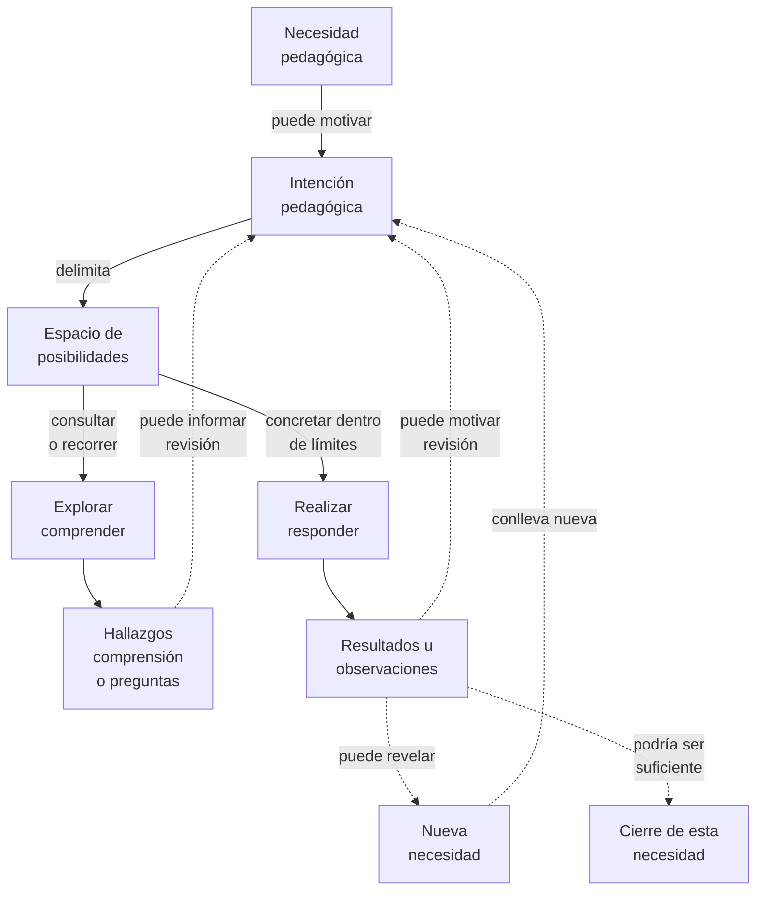

# Resolución recursiva de necesidades pedagógicas

**Estado:** lifecycle candidato de TDidacta; describe coordinación posible, no una secuencia obligatoria ni una adopción metodológica definitiva.

## Responsabilidad de Lifecycle

Coordinar las relaciones entre [necesidad, intención, espacio, operaciones y resultados](../relationships/pedagogical-resolution-relations.md), sin redefinir fundamentos ni mecanismos. Su recursividad representa una posibilidad de continuidad, no una obligación de fragmentar toda necesidad.

## Idea central

Una necesidad pedagógica puede motivar una intención, que delimita un espacio de posibilidades. En dicho espacio se puede **explorar para comprender** y **realizar para concretar una respuesta**.

Una realización puede responder suficientemente a la necesidad, resultar insuficiente o revelar necesidades adicionales. En estos últimos casos puede revisarse la respuesta o formularse otra necesidad e intención, **repitiendo la misma operación a otra escala o desde otro ángulo**.

### Representación visual candidata

**Pregunta de lectura:** ¿cómo pueden relacionarse una necesidad, la intención que la aborda, la exploración, la realización y las continuidades posibles sin imponer una secuencia única?

**Cómo leerlo:** las flechas continuas ayudan a reconocer relaciones principales de este modelo candidato; las discontinuas identifican **continuidades posibles**, no etapas obligatorias. Explorar y realizar son operaciones distintas que pueden alternarse o repetirse; ninguna exige que la otra ocurra antes. Una exploración puede producir comprensión o preguntas sin generar una realización. El retorno desde «Nueva necesidad» al nodo «Intención pedagógica» reutiliza el **concepto visual**, no necesariamente la misma intención: puede formularse una intención nueva con un espacio distinto.

**Alternativa textual:** una necesidad puede motivar una intención; esa intención delimita un espacio de posibilidades. En él se puede explorar para comprender o realizar para concretar una respuesta. Los hallazgos y resultados pueden informar revisiones; una realización puede considerarse suficiente o revelar una necesidad adicional. No se requiere subdivisión, cierre formal ni un orden único.

**Límite:** la posición de los nodos no prescribe fases, jerarquías ni cardinalidades. La aparición de «cierre» no garantiza aprendizaje. El retorno desde «Nueva necesidad» no implica revisar necesariamente la intención anterior ni exige que la nueva necesidad sea más pequeña. El diagrama no demuestra que este lifecycle sea universal ni que haya sido adoptado como metodología.

**Experimento editorial relacionado:** [comparación Mermaid y SVG](visual-comparison-mermaid-svg.md). Se conserva como contraste de formatos, no como segunda definición del lifecycle.

## Recursividad

El diagrama representa la **recurrencia posible del patrón de resolución**, no todas las relaciones entre intenciones. Una realización también puede dar lugar a una intención más específica; esa especialización no es obligatoria ni es la única forma de continuidad.

Una realización sobre una intención amplia puede producir una intención más específica: por ejemplo, una planificación anual puede concretarse en planificaciones de menor alcance y estas en unidades, clases o actividades.

Sin embargo:
- Una necesidad pequeña puede resolverse directamente, sin subdivisión.
- Una necesidad nueva puede ser más pequeña, equivalente, transversal o incluso más amplia.
- Las conexiones entre intenciones también pueden ser por materias, tiempo y personas, sin que una contenga a la otra.
- Explorar puede descubrir que la necesidad fue formulada incorrectamente; realizar no garantiza satisfacerla.
- No todo proceso necesita un docente presente simultáneamente con el aprendiz.

## Lectura investigativa

El modelo sirve para formular preguntas, comparar con artefactos de enseñanza existentes y detectar presiones reales. No presupone que toda práctica educativa use las mismas operaciones ni que el uso de IA sea obligatorio.

## Hipótesis transversal, no conclusión

**Podría** existir una abstracción común entre este ciclo de TDidacta y mecanismos de VSlices y/o PResolver. No se afirma que exista.

**Verificación pendiente:** reconstruir operaciones y fronteras efectivas de VSlices, contrastar semejanzas y diferencias con TDidacta y después extender el análisis a otros flavors. La coincidencia terminológica o una arquitectura familiar heredada no constituye evidencia suficiente de generalidad.

**No abrir una investigación duplicada** antes de revisar las líneas y estudios vigentes en [Research](https://github.com/vslices/research-space).

**Relacionados:** [Necesidades e intenciones](../foundations/pedagogical-needs-and-intentions.md) · [Explorar y realizar](../mechanisms/exploration-and-realization.md) · [Espacios de posibilidades](../mechanisms/possibility-spaces.md).
