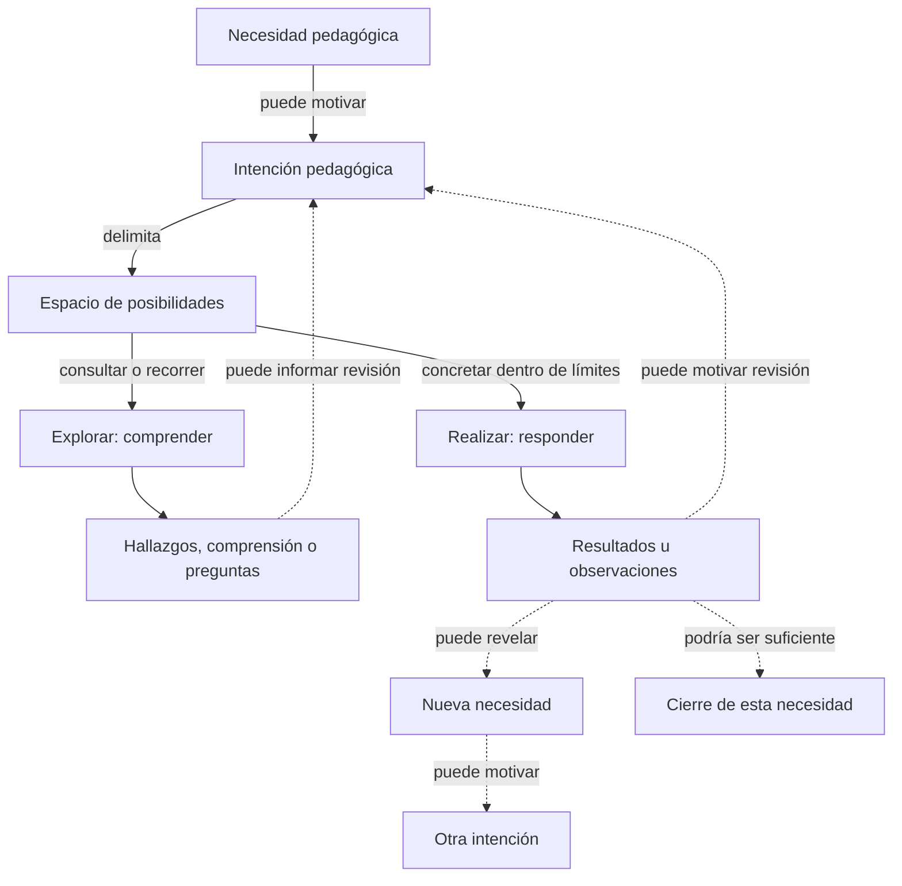
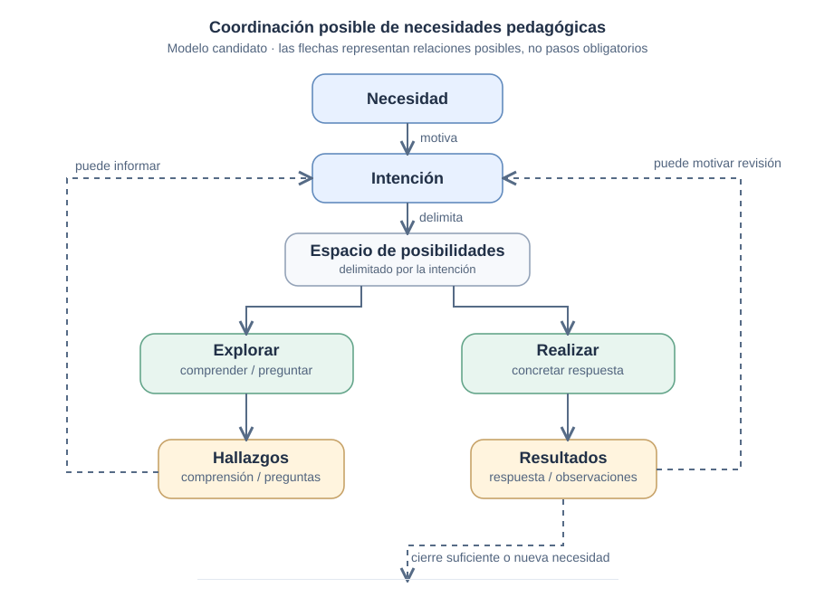

# Lifecycle de TDidacta — comparación visual Mermaid / SVG

**Estado:** experimento editorial comparativo, **no** modificación ni adopción del lifecycle candidato.  
**Fuente semántica:** [Resolución recursiva de necesidades pedagógicas](recursive-pedagogical-resolution.md) y [relaciones candidatas](../relationships/pedagogical-resolution-relations.md).  
**Referencia editorial:** [Visualization Rules v0.1](https://github.com/the-alive-lab/visualization-rules/blob/main/rules/document-visualizations.md).

## Pregunta de la comparación

¿Cuál representación permite comprender mejor la delimitación de una necesidad pedagógica, las operaciones alternativas de exploración y realización, y las continuidades posibles **sin sugerir una secuencia universal**?

## A. Versión Mermaid (editable directamente en Markdown)

**Cómo leerlo:** las flechas sólidas muestran asociaciones centrales del modelo candidato; las punteadas indican continuidades posibles. Explorar y realizar no están ordenados entre sí; ninguna operación es obligatoria antes de la otra.

## B. Versión SVG (composición manual)

[Ver el SVG directamente](assets/recursive-pedagogical-resolution-comparison.svg).

**Cómo leerlo:** el recorrido central orienta la mirada desde la necesidad hasta la delimitación del espacio; las dos ramas distinguen finalidades operativas. Los retornos discontinuos sugieren revisión posible, no una regla temporal.

**Diferencia intencionada:** el SVG pone énfasis en la composición y jerarquía visual, mientras que Mermaid expresa con mayor explicitud algunos destinos posibles (como nueva necesidad y cierre). Por ello **no son representaciones formalmente equivalentes**; la comparación incluye su cobertura y sus omisiones.

## Texto alternativo semántico

Una necesidad pedagógica puede motivar una intención pedagógica. La intención delimita un espacio de posibilidades. Quien enseña, quien aprende o un realizador pueden explorar para comprender o realizar para concretar una respuesta. Los hallazgos y resultados pueden informar la revisión de la intención o revelar necesidades adicionales. Una respuesta también puede considerarse suficiente. No se prescribe orden fijo, fragmentación obligatoria ni garantía de aprendizaje.

## Límites y no-afirmaciones

- El modelo es **candidato**; este archivo no promueve sus relaciones a canon.
- Las flechas y la ubicación no prueban causalidad necesaria, cardinalidad, etapas obligatorias ni autonomía del sistema respecto de las personas.
- Explorar puede terminar en nuevas preguntas sin realización; realizar no garantiza satisfacer la necesidad.
- La intención, el espacio y la realización son conceptos distintos.
- Una necesidad nueva puede ser más amplia, transversal o más específica; no necesariamente una subtarea.
- La comparación es cualitativa; no se ha realizado aún una prueba con lectores, ni se declara un ganador.

## Matriz para evaluar las dos versiones

| Criterio | Mermaid | SVG |
| --- | --- | --- |
| Claridad de lectura | Por evaluar | Por evaluar |
| Fidelidad a la fuente | Por evaluar | Por evaluar |
| Expresividad y control visual | Por evaluar | Por evaluar |
| Mantenimiento tras cambios semánticos | Por evaluar | Por evaluar |
| Accesibilidad y lectura sin renderizado | Apoyada por esta explicación | Apoyada por esta explicación |
| Compatibilidad en GitHub | Bloque Mermaid nativo | Archivo SVG enlazado mediante Markdown |

**Prueba sugerida:** pedir a lectores sin contexto que expliquen el diagrama, distingan relaciones opcionales de obligatorias y localicen una posible interpretación errónea. Después introducir el mismo cambio semántico en ambos formatos y comparar tiempo, errores y claridad.

> **Nota editorial:** en Markdown de GitHub, enlazar un archivo SVG es más fiable que insertar SVG crudo dentro de la página. El SVG se conserva como archivo fuente editable en este repositorio.
