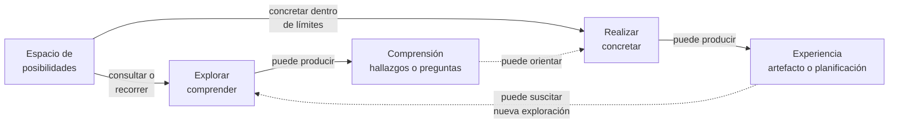

# Exploración y realización

**Estado:** distinciones operativas candidatas, formuladas desde TDidacta; no generalizadas aún a PResolver.

## Superficie común

Ambas operaciones actúan sobre un **espacio de posibilidades delimitado** por condiciones, restricciones y grados de libertad. Pueden ser ejecutadas por quien enseña, quien aprende o un realizador asistido por IA; no pertenecen exclusivamente a un rol.

## Visualización de las dos operaciones

**Pregunta de lectura:** ¿cómo pueden explorar y realizar operar sobre un mismo espacio de posibilidades sin que una operación sea requisito de la otra?

**Cómo leerlo:** las dos ramas parten del **mismo espacio delimitado** y expresan finalidades distintas. Explorar busca comprender; realizar busca concretar una posibilidad bajo sus condiciones. Las conexiones discontinuas representan intercambios **posibles** entre los resultados de ambas operaciones, no un procedimiento de ejecución obligatorio.

**Lectura textual equivalente:** un espacio de posibilidades puede explorarse para comprender relaciones, condiciones o límites, o utilizarse para concretar una respuesta. Explorar puede producir hallazgos, comprensión o preguntas, sin realización alguna. Realizar puede producir una experiencia, un artefacto o una planificación; también puede desembocar en una delimitación más específica. Los resultados de cualquiera de las operaciones pueden alimentar otra operación, sin imponer un orden fijo.

**Límites:** el sentido de las flechas no establece etapas obligatorias ni prioridad de exploración sobre realización. El dibujo simplifica los posibles resultados y no representa exhaustivamente nuevas intenciones o espacios, cambios de alcance ni todos los participantes. Una realización no implica por sí sola que la necesidad pedagógica haya sido satisfecha. La visualización comparte el **estado candidato** de estas distinciones, que no se consideran aún mecanismos generales de PResolver.

## Explorar

**Explorar** es hacer consultas o movimientos en un espacio delimitado para examinar posibilidades, comprender el problema, sus relaciones, condiciones o límites.

Su objetivo es **entender**, no obligatoriamente concretar una respuesta. Puede producir información, hipótesis o nuevas preguntas sin que esos resultados sean por sí solos realizaciones de la necesidad original.

Una consulta que excede el alcance declarado puede continuar, señalando explícitamente ese cambio.

## Realizar

**Realizar** es concretar una posibilidad a partir de un espacio delimitado, bajo sus condiciones y restricciones, para producir una respuesta.

El resultado puede ser material, experiencia, planificación o **una delimitación más específica que origine otra intención y espacio**. No equivale exclusivamente a generar contenido ni garantiza que la necesidad esté satisfecha.

## Diferencia funcional

| | Explorar | Realizar |
| --- | --- | --- |
| Propósito principal | Entender un problema o espacio | Responder concretando una posibilidad |
| Operación | Consultar o recorrer posibilidades | Concretar algo bajo límites declarados |
| Resultado posible | Comprensión, hallazgos, preguntas | Experiencia, artefacto, estructura o nuevo espacio |
| Relación con el ciclo | Aclara la necesidad o sus alternativas | Intenta atender la necesidad |

Las dos operaciones pueden alternarse o repetirse; **no se impone explorar antes de toda realización**. Las salidas de una operación pueden alimentar a la otra.

## Frontera de generalización

Que estas distinciones resulten útiles en TDidacta **no demuestra** que sean mecanismos universales de PResolver. La posible abstracción entre flavors es una hipótesis a investigar contrastando primero con VSlices y después con otros flavors.

**Relacionados:** [Espacios de posibilidades](possibility-spaces.md) · [Resolución recursiva](../lifecycle/recursive-pedagogical-resolution.md).
