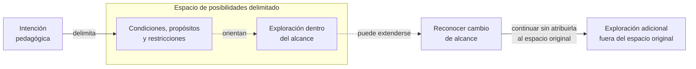

# Espacio de posibilidades pedagógico

**Estado:** candidate. **Antecedente:** realización documentada. **Eficacia comparativa:** no establecida.

## Definición candidata

Un **espacio de posibilidades pedagógico** es el conjunto delimitado de posibilidades resultante de las condiciones, propósitos, restricciones y grados de libertad establecidos por una **intención pedagógica**. La intención expresa la respuesta de quien asume la responsabilidad de enseñar; el espacio resultante puede ser consultado o concretado por personas o por realizadores asistidos por IA.

**Explorar** consiste en consultar o recorrer ese espacio para comprenderlo. **Realizar** consiste en concretar algo a partir de sus posibilidades, respetando sus límites. Las dos operaciones pueden corresponder tanto a quienes enseñan como a quienes aprenden; una realización también puede delimitar un nuevo espacio más específico.

Su formulación intenta preservar orientación pedagógica **sin exigir una única experiencia ni suprimir la autonomía y curiosidad del aprendiz**.

## Alcance y transiciones

### Visualización del límite y su posible extensión

**Pregunta de lectura:** ¿cómo distinguir una exploración dentro del espacio delimitado de otra que continúa fuera de su alcance, sin restringir la curiosidad?

**Cómo leerlo:** el contenedor representa el alcance de posibilidades delimitadas por una intención pedagógica, **no un límite a la curiosidad**. Dentro puede realizarse una exploración conforme a las condiciones declaradas. Si surge interés por algo fuera del espacio original, la exploración puede continuar, reconociendo el cambio de alcance. Las conexiones discontinuas expresan posibilidades, no pasos obligatorios.

**Lectura textual equivalente:** una intención establece condiciones, propósitos, restricciones y grados de libertad que delimitan un espacio. Es posible explorar sus posibilidades para comprenderlas. También puede surgir una pregunta que exceda ese espacio; en tal caso puede seguirse explorando, dejando claro que la nueva exploración no forma parte automáticamente de la intención inicial.

**Límites:** el dibujo solo ilustra la **distinción de alcance**. No presupone una autoridad que deba autorizar preguntas, una etapa formal de transición ni un segundo espacio creado automáticamente. Tampoco representa exhaustivamente realizaciones, múltiples espacios relacionados o la posible conexión con otras clases: esas posibilidades siguen abiertas. El modelo y esta visualización conservan su estado **candidato**, sin demostrar eficacia pedagógica.

Cuando una exploración excede el alcance declarado, puede continuar como exploración adicional, pero debe **identificarse que ya no pertenece al espacio original**, en lugar de presentarla silenciosamente como parte de la misma lección.

Mostrar cómo un punto externo se conecta con clases actuales, anteriores o futuras es una posibilidad por investigar, no una obligación adoptada.

Varios espacios podrían relacionarse en una unidad u otra organización pedagógica. Su composición no constituye aún una regla universal.

## Antecedentes

- **Experiencia del fundador:** Hernán reporta uso favorable de espacios de posibilidades en VSlices. Es testimonio práctico, no demostración comparativa.
- **Caso Teaching:** las [instrucciones de generación de Clean Architecture](https://github.com/HernanFAR/teaching/blob/main/docs/lessons/clean-architecture/generation-instructions.md) expresan en prosa propósitos, exclusiones, recorrido causal, invariantes, variaciones admisibles, restricciones y exploraciones. Son una realización compatible con este concepto, no prueba de universalidad.
- **Investigación relacionada:** [Pedagogical Intent & Realization](https://github.com/vslices/research-space/tree/main/lines/pedagogical-intent-realization) y [PIR-STU-001 — Cross-realizer semantic conformance](https://github.com/vslices/research-space/blob/main/lines/pedagogical-intent-realization/studies/stu-001-cross-realizer-semantic-conformance.md) investigan preservación de obligaciones de fuentes entre realizaciones. No equivalen por sí mismos a una evaluación comparada de eficacia educativa.

## Pregunta abierta

¿Bajo qué condiciones este enfoque ayuda efectivamente a la enseñanza y al aprendizaje, a la autonomía, a la calidad y al esfuerzo humano, comparado con alternativas fuertes?

Antes de proponer un estudio nuevo se debe comprobar la continuidad con la investigación existente.

## No-claims

No se establece un mecanismo universal, formato obligatorio, sintaxis, contrato técnico de Platform ni fundamento estable. La viabilidad observada de una realización no implica superioridad pedagógica general.

**Relacionados:** [Necesidades e intenciones](../foundations/pedagogical-needs-and-intentions.md) · [Explorar y realizar](exploration-and-realization.md) · [Resolución recursiva](../lifecycle/recursive-pedagogical-resolution.md) · [Criterios de madurez](../foundations/scope-and-promotion.md).
